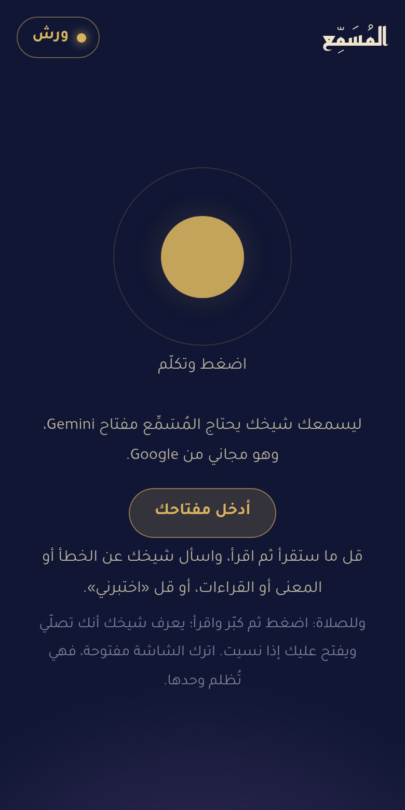
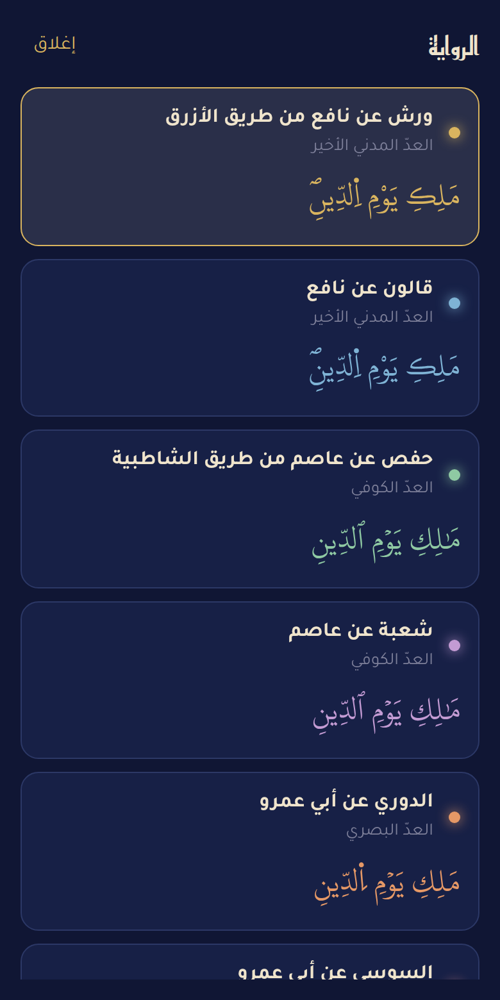
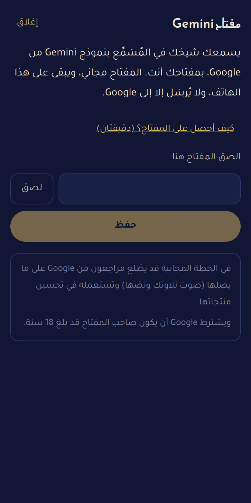
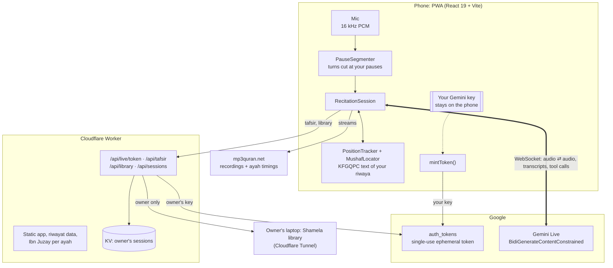
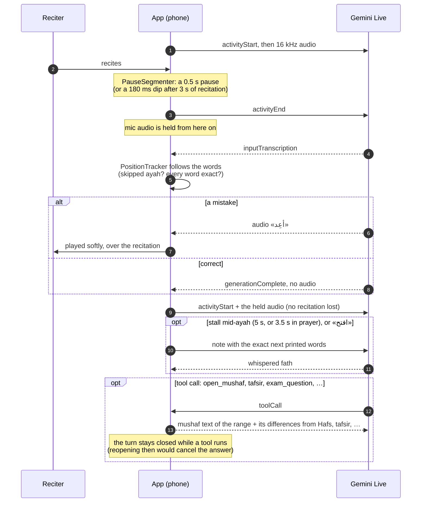

<div align="center">


# المُسَمِّع · al-Musammiʿ

**A voice-only Quran memorisation teacher. It listens to you recite, stays silent while you are right,
says «أعِد» the moment you slip, and prompts the next words when you stall.
Warsh by default, and seven other riwayat of the King Fahd Complex mushafs.**

[](LICENSE)
[](https://ai.google.dev/gemini-api/docs/live)
[](https://workers.cloudflare.com)
[](https://react.dev)
[](client/public/manifest.json)

[**Open the app**](https://musammi.benjelloun.dev) · [دليل البدء بالعربية](https://musammi.benjelloun.dev/guide) · [How it works](#how-it-works) · [Run your own](#run-your-own) · [Support the project](#support-the-project)

</div>

<div dir="rtl">

## ابدأ في دقيقتين

**المُسَمِّع** شيخ يسمع حفظك للقرآن بصوتك على الهاتف: يسكت ما دمتَ مصيباً، ويقول «أعِد» عند الخطأ، ويفتح عليك إذا نسيت، ويرافقك في الصلاة. برواية ورش أصلاً، وبسبع روايات أخرى.

1. افتح [صفحة المفاتيح في Google AI Studio](https://aistudio.google.com/apikey)، وادخل بحساب Google، واضغط «Create API key» ثم انسخ المفتاح. **المفتاح مجاني.**
2. افتح [التطبيق](https://musammi.benjelloun.dev) واضغط «أدخل مفتاحك»، ثم «لصق» و«حفظ». يبقى المفتاح على هاتفك، ولا يُرسَل إلا إلى Google.
3. أضفه إلى الشاشة الرئيسية (في Chrome: ⋮ ← «تثبيت التطبيق»؛ في Safari: المشاركة ← «إضافة إلى الشاشة الرئيسية»).
4. اضغط الدائرة، وقل ما ستقرأ («سأقرأ سورة الملك») ثم اقرأ. قل «افتح» إذا نسيت، و«اختبرني» للأسئلة، وللصلاة كبّر واقرأ.

الشرح المفصّل للمبتدئين: **[musammi.benjelloun.dev/guide](https://musammi.benjelloun.dev/guide)**.

> [!IMPORTANT]
> في الخطة المجانية قد يطّلع مراجعون من Google على ما يصلها (صوت تلاوتك ونصّها) وتستعمله في تحسين منتجاتها، ويشترط Google أن يكون صاحب المفتاح قد بلغ 18 سنة.

</div>

---

<p align="center">
  
  &nbsp;
  
  &nbsp;
  
</p>

## What it does

| | |
|---|---|
| **Listens, mostly in silence** | Correct recitation gets no reply at all: no «أحسنت» at every ayah end. A mistake gets one soft word, «أعِد», played over your recitation so you can correct on the spot. |
| **Fath when you stall** | Stop mid-ayah for 5 s (3.5 s in prayer) or say «افتح», and the teacher whispers the next words. The app supplies the exact printed words up to the next waqf mark or the ayah's end, so the teacher never prompts from memory. |
| **Eight riwayat** | Warsh (default), Qalun, Hafs, Shuʿba, al-Duri, al-Susi, al-Bazzi and Qunbul: each with its own KFGQPC text, font, ayah count and list of differences from Hafs. Pick one from the badge, or ask for it by voice (the teacher confirms first). |
| **Prayer mode** | Say «الله أكبر» and the app knows you are praying: the screen goes dark but stays on, the teacher says only «أعِد» on a mistake and gives the fath only when you stall. «السلام عليكم» ends it. The app finds your place in the whole mushaf by itself. |
| **Exams** | «اختبرني»: questions drawn from the mushaf of your riwaya. Continue from an ayah's start, recite the previous ayah, start of a juz, mutashabihat, and "where is this?". An answer recited from a different place is caught and named. |
| **Meanings and qiraʾat** | Ask what an ayah means and the teacher answers from Ibn Juzay's tafsir. In the owner's build, other tafsirs and the qiraʾat books (البدور الزاهرة، النشر، الإتقان) are read live from the owner's Shamela library. |
| **Recorded mushaf** | «أسمعني…» plays murattal recordings from mp3quran.net, cut to the exact ayat when timings exist (e.g. al-Kushi and al-Husary for Warsh, al-Shuraim and al-Minshawi for Hafs). |
| **Memory** | Past sessions stay on the phone, and the teacher can go over your earlier mistakes. |

## How it works

### Architecture



The audio never goes through the Worker: the phone talks to Gemini Live directly, with a token that has the
**whole session setup locked in** (prompt, tools, manual turn-taking, transcription, resumption handle). The
setup is built in one place, [`client/src/live/token.ts`](client/src/live/token.ts), and both ways of minting
the token call it:

| | Owner mode | Your own key |
|---|---|---|
| Opened with | the private link `/?k=ACCESS_KEY`, once | the app's address; key pasted once |
| Token minted by | the Worker, with the owner's `GEMINI_API_KEY` | your browser, with your key, straight at Google |
| Gemini quota | the owner's | yours (free tier works) |
| Tafsir and library | Ibn Juzay + the laptop's Shamela books | Ibn Juzay |
| Sessions saved | phone + Cloudflare KV | your phone only |

### One live turn

Gemini's automatic voice detection drops melodic recitation, so the app drives the turns itself, closing each
one at your own pauses (waqf, breath):



### What makes it hard, and what the code does about it

<details>
<summary><b>Recitation is not speech.</b> Voice activity detection, transcription and the model all lean on everyday speech.</summary>

- **Manual turns** ([`pauses.ts`](client/src/live/pauses.ts)): an adaptive noise floor, a turn cut at a 0.5 s pause while
  reciting and at 1.3 s while talking, so a question is not cut mid-sentence. Long continuous recitation is
  cut at the next short dip after 3 s, so «أعِد» never comes late.
- **Turn-taking that never cancels an answer** ([`session.ts`](client/src/live/session.ts)): the next `activityStart`
  waits for `generationComplete`, or 1.5 s of silence, or a 5 s hard timer. Audio recorded meanwhile is held and
  flushed. The turn is never reopened while a tool runs.
- **Hafs bias**: transcription leans to the best-known riwaya. With every range of the mushaf, the model gets
  that range's farsh words that differ from Hafs (464 for Warsh, up to 793 for al-Susi), and the tracker
  accepts the Hafs form at those words without ever counting it as an exact match.
</details>

<details>
<summary><b>The model must judge against the printed mushaf, not its memory.</b></summary>

- `open_mushaf` returns the exact KFGQPC text of the place being recited (up to 10 pages / 160 ayat), in the
  riwaya's own ayah count.
- [`PositionTracker`](client/src/live/reference.ts) follows the reciter word by word, reports skipped ayat to the
  teacher, and supplies the fath: the printed words up to the next waqf mark.
- [`MushafLocator`](client/src/live/reference.ts) finds a recited stretch anywhere in the mushaf, waiting
  while mutashabihat still fit several places. Prayer mode uses it to find your place, and exams
  use it to catch an answer recited from somewhere else.
- In prayer, a «أعِد» after a stretch whose words all matched exactly and that stopped mid-ayah is muted (a pause
  mistaken for a slip).
</details>

<details>
<summary><b>Phones echo, networks drop, sessions run long.</b></summary>

- **Echo**: the phone's echo canceller lets the teacher's voice back into the mic. While an answer longer than
  1.5 s plays, the segmenter is deaf to it. Only transcribed words that are not the teacher's own, and not
  «طيب»/«نعم», stop the answer, and the teacher is told how much was heard, so «أكمل» resumes from there.
- **Reconnects**: a dropped connection resumes with the last session-resumption handle, or falls back to a new
  context. Each attempt gets 15 s, retries back off exponentially within a 60 s budget, and more than 4 drops in
  2 minutes end the session rather than loop. Up to 75 s of mic audio is held so no recitation is lost. The
  first turn after a reconnect carries a note of where things stood (prayer, exam, place).
- **Quota**: a session ends by itself after 3 minutes with no recitation and no reply (20 minutes in prayer).
</details>

<details>
<summary><b>Keys and access.</b></summary>

- The token is single-use, expires after 30 minutes, and must open its session within 2 minutes. A client
  holding it cannot change the prompt or the tools.
- Your own key is kept in your browser's storage and sent only to Google's token endpoint. The owner's key
  stays a Worker secret behind `ACCESS_KEY` (compared in constant time).
- The owner's laptop library is reachable only through the Worker with `ACCESS_KEY`. Without it, those
  books answer "not in this version".
</details>

### The data

| Riwaya | Ayah count | Ayat | Words that differ from Hafs (farsh) |
|---|---|---:|---:|
| Warsh ʿan Nafiʿ (al-Azraq) | Madani (last) | 6,214 | 464 |
| Qalun ʿan Nafiʿ | Madani (last) | 6,214 | 727 |
| Hafs ʿan ʿAsim (Shatibiyya) | Kufi | 6,236 | — |
| Shuʿba ʿan ʿAsim | Kufi | 6,236 | 317 |
| al-Duri ʿan Abi ʿAmr | Basri | 6,217 | 720 |
| al-Susi ʿan Abi ʿAmr | Basri | 6,217 | 793 |
| al-Bazzi ʿan Ibn Kathir | Makki | 6,220 | 495 |
| Qunbul ʿan Ibn Kathir | Makki | 6,220 | 488 |

Built by [`scripts/build_riwayat.py`](scripts/build_riwayat.py) from the KFGQPC data. Per riwaya it writes
the text (as published, plus a letters-only key for matching speech), surah names, about 395 mutashabihat
phrases for the exam, the farsh differences, the mapping to Hafs ayah numbers (for tafsir indexes), and the
font. Ibn Juzay's tafsir is served per ayah as static JSON; it is **not** in this repository (see
[THIRD_PARTY.md](THIRD_PARTY.md)).

## Run your own

You need Node.js 23 or newer (developed on 24) and, for the live teacher, a Gemini key.

```bash
git clone https://github.com/kmbenjel/musammi && cd musammi
npm install                                  # the Worker and the Google SDK
(cd client && npm install && npm run build)  # the app, into client/dist
npx wrangler dev                             # http://localhost:8787, then paste your key in the app
```

<details>
<summary><b>Deploy it on your Cloudflare account</b></summary>

1. `npx wrangler login`, then `npx wrangler kv namespace create SESSIONS`, and put the printed id in
   [`wrangler.toml`](wrangler.toml).
2. In `wrangler.toml`, replace the `routes` line with your own domain (or remove it to use `*.workers.dev`),
   and remove `LIBRARY_ORIGIN` unless you run a library server.
3. `(cd client && npm run build) && npx wrangler deploy`.

Everyone then uses their own key. For an owner mode with your own quota and saved sessions:
`npx wrangler secret put GEMINI_API_KEY`, `npx wrangler secret put ACCESS_KEY`, and open `/?k=<ACCESS_KEY>` once
on each phone.
</details>

<details>
<summary><b>Project layout</b></summary>

```text
client/                 the app (React 19, Vite): one screen, one ink dot
  src/live/session.ts     the live session: mic → Gemini Live → speaker, turns, fath, prayer, reconnects
  src/live/pauses.ts      turn cutting at the reciter's pauses
  src/live/reference.ts   PositionTracker, MushafLocator, the mushaf text sent to the model
  src/live/prompt.ts      the teacher's instructions and tools (one source for every token)
  src/live/token.ts       the ephemeral token, minted by the Worker or by the browser
  src/live/riwayat.ts     the eight riwayat; src/live/audio.ts the recorded reciters
  src/KeySheet.tsx        bring your own key
  public/riwayat/<key>/   KFGQPC text, fonts and derived data; public/guide.html the Arabic guide
worker/index.ts         Cloudflare Worker: static app, token for the owner, tafsir, library proxy, sessions
server/                 the owner's laptop: Shamela library API behind the tunnel
scripts/                data builders (riwayat, tafsir export), Shamela daemon, forced alignment (on hold)
skills/                 the teacher's specification, as a Gemini app skill
test/                   data checks: node test/verify_warsh_logic.js
```
</details>

## Privacy and terms

- **Your voice** goes from your phone to Google's Gemini Live, nowhere else. On the free tier, Google may have
  human reviewers read what it receives and use it to improve its products; with billing enabled it does not
  ([Gemini API terms](https://ai.google.dev/gemini-api/terms)). Google requires users to be 18 or older.
- **Your key** stays in your browser and is sent only to Google.
- **Your sessions** stay on your phone. Only the owner's own sessions (private link) are saved to the owner's Cloudflare KV.

## Status and roadmap

The app grew out of its author's own hifz sessions: every session saves an event log, and the logs drive the next
fix. Known gaps and next steps:

- [ ] False «أعِد» on correct Warsh *usul* (tas-hil, taqlil, imala), where transcription hears Hafs
- [ ] Reconnect before Gemini's 10-minute connection limit instead of after it
- [ ] Ayah timings for riwayat that have none (Qunbul), by forced alignment ([`scripts/align_timings.py`](scripts/align_timings.py), on hold)
- [ ] The qiraʾat library for everyone, not only on the owner's laptop
- [ ] No key at all for ordinary people: a hosted tier, outside Google's free-tier data use

## Support the project

المُسَمِّع is built by one developer, in the open. If it helps you or someone you teach:

- **Use it and report**: open an issue with what the teacher got wrong (the time, the surah and ayah, what you recited).
- **Sponsor**: sponsorship would fund the hosted tier and the work on the roadmap.
- **Partner or invest**: making it bigger and simpler (a hosted tier with no key, halaqa and teacher dashboards,
  more riwayat audio) needs funding. Reach out through [the author's GitHub profile](https://github.com/kmbenjel).

## Credits and licence

- Quran text and fonts: [King Fahd Glorious Quran Printing Complex](https://qurancomplex.gov.sa/quran-dev/).
- Recorded recitations and ayah timings: [mp3quran.net](https://mp3quran.net) and its reciters.
- Tafsir: «التسهيل لعلوم التنزيل» of Ibn Juzay al-Kalbi (d. 741 AH).
- The live teacher: Google's Gemini Live API.

The code is licensed under the [GNU AGPL-3.0](LICENSE). The Quran text, fonts and other third-party content keep
their own terms: see [THIRD_PARTY.md](THIRD_PARTY.md).
