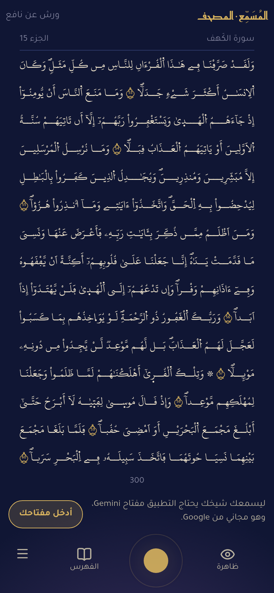
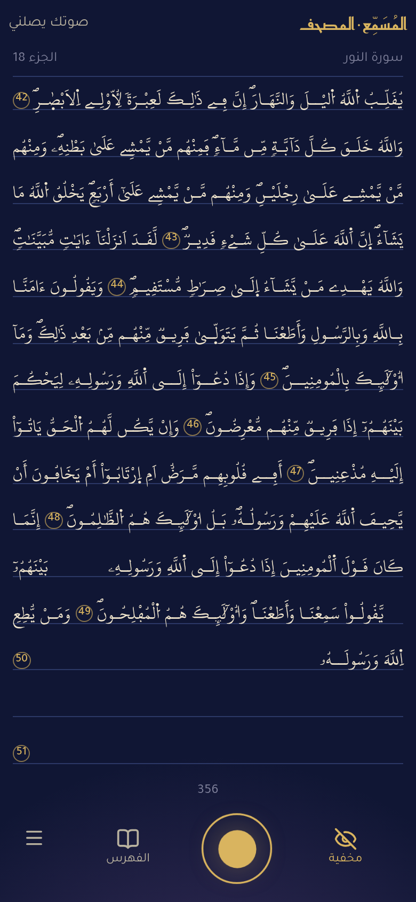
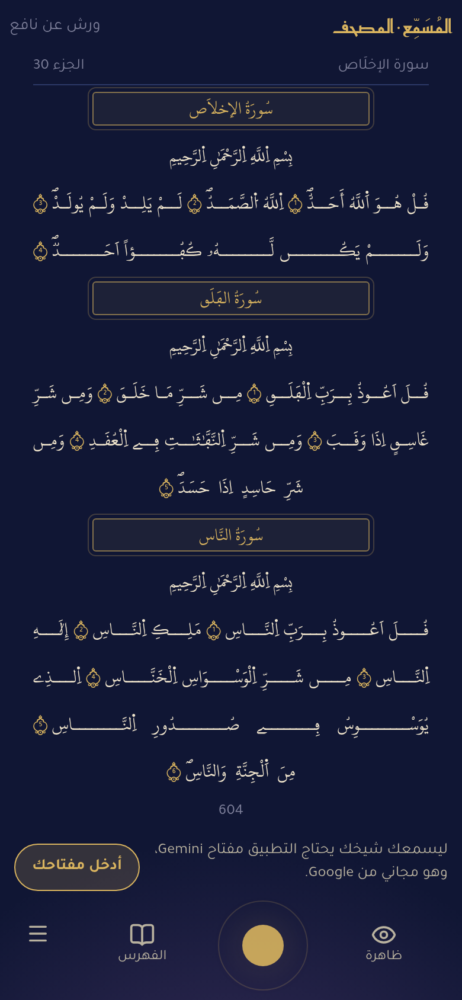

# Mushaf mode · وضع المصحف

> **Experimental.** A second way to use al-Musammiʿ, being tried with a few people before it is decided whether it
> stays: **[musammi.benjelloun.dev/mushaf](https://musammi.benjelloun.dev/mushaf)**. It is not affiliated with Tarteel AI
> or any other app.

<p align="center">
  
  &nbsp;
  
  &nbsp;
  
</p>

<div dir="rtl">

## باختصار

بدل شاشة الكلام، **صفحة المصحف** أمامك: مصحف المدينة (مجمع الملك فهد، ١٤٤١)، رواية ورش عن نافع من طريق الأزرق، بخط ورش الذي في المُسَمِّع، خمسة عشر سطراً مستوية في كل صفحة، وأرقام الآيات بالأرقام العادية (1، 2، 3).

- **أظهِر الكتابة أو أخفِها** بزرّ العين. إذا أخفيتَها كتب التطبيق ما تقرؤه صواباً في موضعه من الصفحة، كلمةً كلمة، وآخر كلمة بالأخضر لحظة. وإذا بدأتَ من وسط الصفحة ظهر ما قبل موضعك منها.
- **«أعِد»** عند الخطأ كما في المُسَمِّع: يمحو التطبيق ما كتبه من ذلك المقطع، ويعلّم موضع الخطأ بالأحمر، ويبقى أثره خفيفاً في الصفحة إلى آخر الجلسة.
- **الأسطر مستوية بالكشيدة** كما في المطبوع، موزّعة على كلمات السطر بالتساوي.
- **لا فتح أبداً**، لا عند السكوت ولا عند الطلب: الصفحة بين يديك، أظهِرها بالعين، أو اضغط عليها مطوّلاً فتظهر ما دمتَ ضاغطاً.
- **قلّب إلى صفحة** فأنت تقرأ منها. **واقرأ من موضع آخر قاصداً** فتنتقل الصفحة إليه، وتنقلب وحدها حين تتمّ آخر سطر فيها.
- **«أسمعني…»** يتلو العيون الكوشي، فتنتقل الصفحة إلى موضعه ظاهرةً، وتُعلَّم الكلمة التي يتلوها، ثم تعود الكتابة كما كانت.
- **الصلاة** كما في المُسَمِّع: كبّر واقرأ، تُظلم الشاشة، ولا يقول شيخك إلا «أعِد».
- **«اختبرني»**، والجلسات السابقة، و«حسبك»، والمكتبة (البدور الزاهرة، النشر، الإتقان) كما هي. **لا تفسير** في هذا الوضع، ولا رواية غير ورش.
- **الفهرس**: السور بصفحاتها، أو رقم صفحة. والرابط `?p=50` يفتح الصفحة 50.

</div>

## What changes, and what does not

The mode reuses the whole live engine of al-Musammiʿ (`client/src/live/`): the same Gemini Live session, turn
cutting at pauses, position tracker, breath guard, echo guard, handover before Google's 10-minute cut, salat
detection, exams, recordings and the stop word «حسبك». What differs:

| | al-Musammiʿ | Mushaf mode |
|---|---|---|
| Screen | the conversation: what you recited (as printed, when right) and the teacher's replies | the mushaf page; the teacher's last remark floats over it for 7 s |
| Riwayat | eight | Warsh only |
| Fath | after 5 s of silence mid-ayah (3.5 s in prayer), on «افتح», on istiṭʿām in prayer | **never**; on «افتح» the teacher whispers «أظهِر الصفحة» |
| In prayer | «أعِد» and the fath | «أعِد» only (any other reply is muted by the app, not only by the prompt) |
| Tafsir | Ibn Juzay, and the owner's Shamela tafsirs | none (the tool is not declared) |
| «أرني الآية» | a card with the ayah | the page of that ayah, shown |
| A recording | plays | plays, turns to its page, shows it, follows al-Kushi word by word |

It is the same app at the path `/mushaf`: the same origin, so a Gemini key or private link already saved in
al-Musammiʿ serves it too, with nothing to enter again, and the same Worker with its secrets. Installed from there
(«تثبيت التطبيق»), it is an app of its own that opens on `/mushaf`. Everything mode-specific is behind
`mode: 'mushaf'` in the session and the prompt, so al-Musammiʿ itself behaves exactly as before. Its first address,
tarteel-warsh.benjelloun.dev, sends there (302).

## How it works

### 1. The pages: Madina layout, our font

The KFGQPC Warsh data (`data/riwayat/warsh/data.json`) gives each ayah its page and its first and last line on that
page (four ayat cross a page). It does not say where an ayah's words break between its lines. The app's Warsh font
is not the calligraphy the mushaf was printed in, so its words have other widths, and the breaks have to be chosen
again.

[`scripts/build_mushaf_layout.py`](../scripts/build_mushaf_layout.py) does that once, at build time:

1. Every printed word (a token with letters; «۞» goes with the word after it, the ayah's end is the font's own ornament, ۝, with the number in plain digits inside it)
   is measured in the font with HarfBuzz.
2. The words of the whole mushaf are laid out by dynamic programming, under the data's constraints: each ayah
   starts on its first line and ends on its last, its words never leave them, and a line may hold the end of one
   ayah and the start of the next. Among the layouts that keep to them, it takes the one whose lines come closest to
   a common width **W**, the width of a full line (the 98.5th percentile of the line widths).
3. Surah frames and the basmala fill the two lines before each surah's first ayah (one line for at-Tawba).
4. **Kashida.** Each line is then brought to W as print does it, by stretching letters: the tatweels it lacks are
   shared out evenly among its words, one word after the other (at most 8 in a word), each at the word's last
   joining point (after the marks of the letter before it; never inside lam-alif or the name of Allah). Every
   stretched word is measured again, since a tatweel can undo a ligature, and the line is trimmed if it overshoots.
   Before kashida the median line fills 80 % of W; after it, 99.2 % (5th percentile 98.5 %). The four lines that
   cannot reach 85 % (few words, few joining letters: the end of a surah) stay unstretched and centred.
5. It writes `client/public/riwayat/warsh/mushaf.json` (970 KB, about a quarter of that gzipped): for each page, its
   15 lines as `[ayah id, first word, last word]` segments; `k`, the kashida as `[ayah id, word, character, count]`
   (59,972 words); `f`, a font scale for the 38 pages that hold a line longer than W (smallest 0.86); and `c`, the
   centred lines.

In the browser ([`MushafView.tsx`](../client/src/mushaf/MushafView.tsx)) the font is sized so that W fills the
page's width (and 15 lines its height), the tatweels are put into the words, and each line spreads its words to both
edges for the little that is left. Pages 1 and 2 are centred, as in print.

```sh
uv run --with uharfbuzz --with fonttools --with brotli scripts/build_mushaf_layout.py
```

### 2. Writing what was recited right

The position tracker (`PositionTracker`, [`reference.ts`](../client/src/live/reference.ts)) already follows the
reciter word by word through the live transcript. It now also keeps `hits`, every text word it matched, and
`printedAt(k)` maps its normalized words back to printed words (one printed word can normalize to two words, or to
none).

The session ([`session.ts`](../client/src/live/session.ts), «mushaf mode» section) turns that into what the page
shows:

- `reveal()` after each transcript: the new hits are written at once (`onWords`), and the page follows the next word
  to recite (`onPlace`), so it turns when a page is finished. The word just written stays green for 1.2 s.
- The first words written on a page he started in the middle of bring the rest of the page before them: he is
  past it (App.tsx `onWords`).
- `judged()` when the turn reopens with no «أعِد»: the words between two hits of the stretch are written too, and one
  or two between it and the stretch before it. The transcript drops words, mishears one at a cut («ليحكم» as «وما»),
  and never matches one-letter openings («صٓ», «قٓ», «نٓ»).
- `missed()` when the teacher's «أعِد» is played (not when the breath guard mutes it): that stretch's words are taken
  back and its first word is marked (`onMiss`, red for 4 s, then a faint patch for the rest of the session, hidden or
  not). He repeats, and they are written again.

These follow a screen recording of the behaviour the owner wanted (Tarteel, Hafs, Maryam 49–50): the page before
the starting point appears once the place is found, the newest word is green, and the places of mistakes stay
marked on the page.

### 3. Following the reciter

- **He turns the page** and stays on it for 1.2 s: `openAt()` opens the tracker on that page and the 10 after it,
  with the place not yet confirmed, so a stretch read anywhere on them places him. The teacher gets that page's
  text (three pages of it; more follow as he nears the end, as before).
- **He starts the session**: from the page shown. The last session's place (within 15 minutes) is only kept if it
  is on that page.
- **He recites from elsewhere on purpose**: the tracker's existing move detection, or the whole-mushaf locator,
  places him, and the page follows.
- **A recording plays**: `onShow` turns to its first ayah and shows the page; with al-Kushi's word timings
  (`client/public/riwayat/warsh/words/laayoun-kouchi/`) the word being recited is marked and the page follows it.
  When the recording stops, the writing goes back to hidden if it was hidden.

### 4. The teacher

`systemInstruction(riwaya, 'mushaf')` ([`prompt.ts`](../client/src/live/prompt.ts)) is the same prompt with the
fath rules replaced by "never give a fath", no tafsir, no other riwaya, and its own «عن التطبيق». `liveConfig`
drops the `tafsir` and `set_riwaya` tools. The mode travels in the token request (`/api/live/token`, `mode`), or into
the token the browser mints with the reciter's own key.

## Who can use it

- **With your own Gemini key**: the key saved in al-Musammiʿ on this phone serves here too; otherwise «أدخل مفتاحك».
  The key stays on the phone.
- **The owner's private link** (`?k=ACCESS_KEY`): his key, his sessions saved and, as in al-Musammiʿ, his audio.
- **Guest links** for the people the owner lets try it, on his Gemini key: each guest has a key of their own,
  `g-<name>-<random>`, that can be revoked alone. A guest's sessions are saved with `guest: <name>`. Guests cannot
  read sessions, and their audio is never recorded (the app checks the `g-` prefix, the Worker refuses it too).
  They share the owner's daily Gemini quota.

```sh
node scripts/guest_keys.mjs add amina      # prints https://musammi.benjelloun.dev/mushaf?k=g-amina-…
node scripts/guest_keys.mjs remove amina
node scripts/guest_keys.mjs list
```

The keys are kept in `.guests.json` (not in git) and sent to the Worker as the secret `GUEST_KEYS`.

## Deploy

Nothing of its own: it ships with al-Musammiʿ (`npx wrangler deploy`), with its sessions in the same store, marked
`mode: "mushaf"`. The old host's redirect is `[env.mushaf]` in [`wrangler.toml`](../wrangler.toml)
(`npx wrangler deploy --env mushaf`, no secrets).

## Tests

[`test/mushaf_words.ts`](../test/mushaf_words.ts) (build and run lines at its top) checks:

- every printed word of all 6,214 ayat is reached when the ayah is recited as printed;
- the layout places every printed word once, in order;
- through the session: a stretch writes its words and the page follows, «أعِد» takes them back and marks the place,
  a dropped word is written once the stretch passes, and so is one lost between two stretches; «صٓ» is written after
  the stretch that follows it, «افتح» asks
  no fath, and turning to a page sends its text to the teacher.

The existing tracker, breath guard, echo guard, phrase and stop word tests pass unchanged. End to end, a real
recording of the owner reciting an-Nur 47–52, played as the microphone into a headless browser against the live
model, wrote 62 words on the hidden page, turned from page 356 to 357 when its last line was done, took a word back
on a «أعِد», and wrote it again on the repetition.

## Known limits

- **Kashida is placed by rule, not by a calligrapher.** One point per word (its last joining point), the same
  length for every word of a line; print chooses where and how long each stretch is. A few short lines (page 604)
  come out with long stretches.
- **Mistakes are marked by stretch, not by word.** The model says «أعِد» for a stretch; it does not say which word
  was wrong, so the first word of the stretch is marked.
- **Words the transcript turns into Hafs** (`مالك` for `مَلِكِ`) are matched as the word, as in al-Musammiʿ: they
  are written, and only the teacher's «أعِد» takes them back.
- **Only al-Kushi is followed word by word**; the other recordings turn to the page without marking words.
